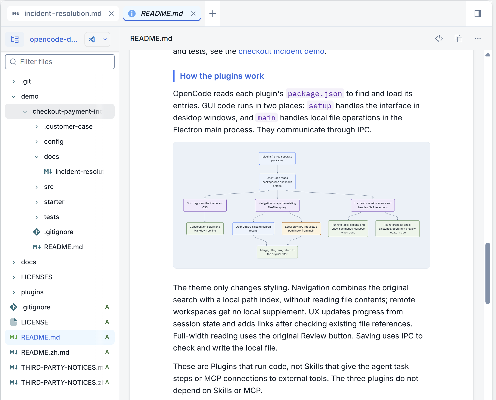
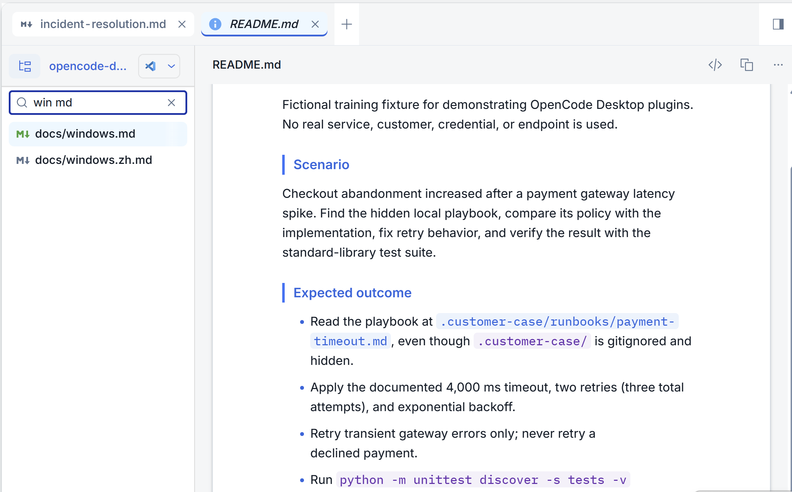
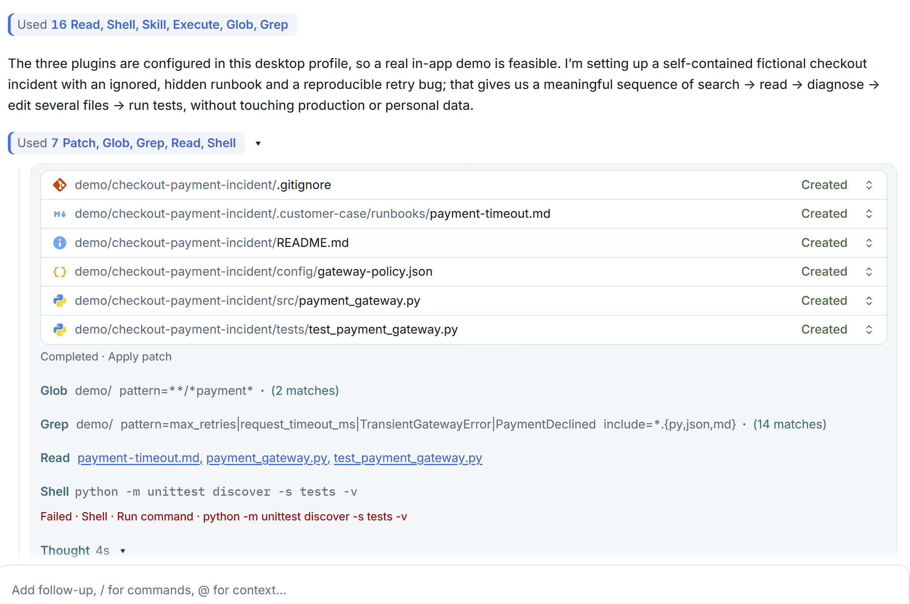
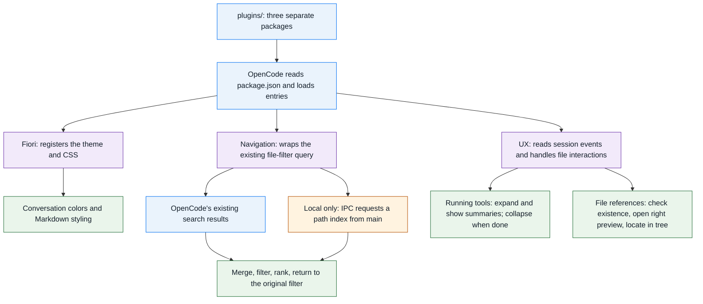

# OpenCode Desktop Plugins

[中文](README.zh.md)

## What is this

Three small plugins to make OpenCode Desktop easier to use.

## Background

After recently moving to OpenCode, I started using it for daily work and ran into a few things that did not feel right: the theme was not to my taste, reading documents felt awkward, and the execution feedback was hard to understand.

In the AI age, when it is time to act, I put AI to work and tried making a few changes.

This project shares those changes and the thinking behind them. It is not an official migration report.

**This is a personal project, not an official SAP product.**

In principle, this code is cross-platform, but I have only tested the plugins as a whole on my current Windows computer and the OpenCode Desktop version I currently use. Other computers, versions, and operating systems, including macOS, are unverified.

## What it does

> **Screenshot note:** All screenshots use fictional demo data and do not represent real customer cases or incidents.

### Fiori Horizon: a look closer to SAP Fiori

I personally found OpenCode's built-in theme too plain and wanted a light style closer to SAP Fiori. It changes both the colors in the main conversation and the Markdown styling in the document viewer, including headings, tables, quotes, and inline code. It is more than a background change, but it is not an official SAP theme.

### Workspace Navigation: find more files and see where they belong

The file panel's built-in search does not find everything, and opening a file does not automatically expand its parent folders or select the corresponding tree item. The search enhancement keeps the existing input and searches file names and paths, including files in hidden and gitignored directories. Enter multiple words to narrow the results, such as `report md` or `docs report md`.

Automatic parent-folder expansion, selection, and scrolling are currently provided by **UX Enhancements**. Enable both plugins to get search and file-tree following together.

### UX Enhancements: clearer progress and easier access to results

Since I started using OpenCode, it has often felt a little slow. But I could not tell whether execution was actually slow or whether the lack of visible changes made the wait feel longer. So I first set out to make execution feedback clearer: what is happening, how far it has progressed, and when it finishes. This improves the waiting experience; it does not make the model or tools run faster.

- Tool groups open while work runs and show command and action summaries. They close after a later reply appears or execution ends. Reopen them when you need the details; the original commands and output remain available.
- Existing file paths in a reply, including paths in a list at the end, can be clicked to open in the right sidebar. The plugin does not generate file lists for the model.
- A document can fill the right-side panel while the conversation is temporarily hidden, making it easier to focus on reading. Toggle again to return to the conversation. This is full-width reading inside the app, not Windows full screen.

When a file opens, its parent folders are also expanded, and the file is selected and scrolled into view in the tree. You can also edit local text files or copy file contents and paths.

Use all three plugins together, or copy only the folders you need. Search and UX do not depend on the theme. These plugins make no additional model calls and do not modify OpenCode's installation files.

## How the plugins work

OpenCode reads each plugin's `package.json` to find and load its entry points. GUI code runs in two places: `setup` handles the interface in desktop windows, while `main` handles local file operations in the Electron main process. They communicate through IPC.

The theme only changes styling. Navigation combines the original search with a local path index without reading file contents; remote workspaces get no local supplement. UX updates progress from session state and adds links after checking existing file references. Full-width reading reuses the original Review button. Saving uses IPC to check and write the local file.

These are Plugins that run code, not Skills that give an agent task steps or MCP connections to external tools. The three plugins do not depend on Skills or MCP.

The source is in [plugins/](plugins/). The `.cjs` files are hand-written source and can also be loaded directly as GUI entries. The theme uses OpenCode's Theme and Style APIs. The search wrapper and some UX behavior depend on the current desktop UI structure, so they may need changes after an OpenCode update.

## Make it yours

The main thing I want to share is an idea, not my color choices.

To borrow Stephen Chow's words: **“Creating something is very subjective, but I will definitely follow up on your criticism.”**

Taste is subjective too, and AI can adapt to your preferences. Ask AI to make changes one at a time until you are happy with the result.

The `test.cjs` files beside each plugin are optional developer tests, not installation steps. OpenCode does not run them during normal use. No separate build or release package is needed.

## Install

On GitHub, choose **Code → Download ZIP** and extract it. Then copy the plugin folders you need from **plugins** into:

`~/.config/opencode/plugins`

`~` means your home directory. Example paths:

- **Windows:** `C:\Users\<your user>\.config\opencode\plugins`
- **macOS:** `/Users/<your user>/.config/opencode/plugins`

Replace `<your user>` with your user folder name. In Windows File Explorer, use the actual path, not `~`. In macOS Finder, use **Go to Folder** and enter `~/.config/opencode/plugins`. The macOS path is for reference only; the plugins have not been tested on a Mac.

See the [Windows manual guide](docs/windows.md) for installation, use, and removal.

## Limits and care

- The GUI API is experimental. An OpenCode update may break the UI adaptations. Turn off an affected plugin if that happens.
- Search reads names and paths, not file contents. Local indexing skips symbolic links and common dependency/cache folders; it scans up to 150,000 files, caches for 15 seconds, and returns up to 5,000 results. Remote workspaces get no local supplement.
- The editor supports local text files up to 2 MB. Saving writes directly to the original file and is not atomic. Unsaved drafts are lost when the window closes. Back up important files or use version control; this is not a full IDE.
- Plugins can access local files. Desktop file actions do not go through agent permission prompts. Diagnostic JSON under `%LOCALAPPDATA%\Temp\opencode` may contain file paths; review it before sharing.
- Supporting labels are available in English and Chinese; they do not control the model's language. Offline tests have passed, but the latest standalone search, live language switching, and some desktop actions still need full manual checks.

## License

This project's code and documentation are under the [MIT License](LICENSE). Horizon color references retain their [third-party notices](THIRD-PARTY-NOTICES.md) and Apache-2.0 license. This project is not affiliated with, endorsed by, or supported by SAP SE or the OpenCode maintainers.
