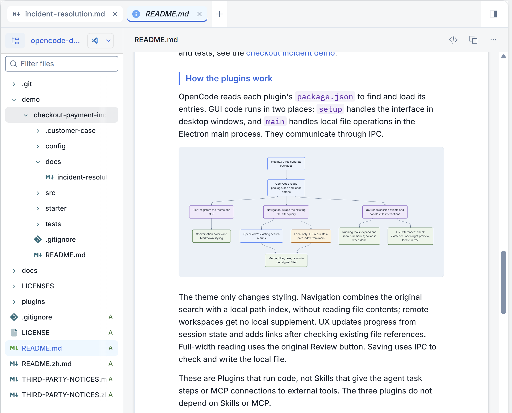
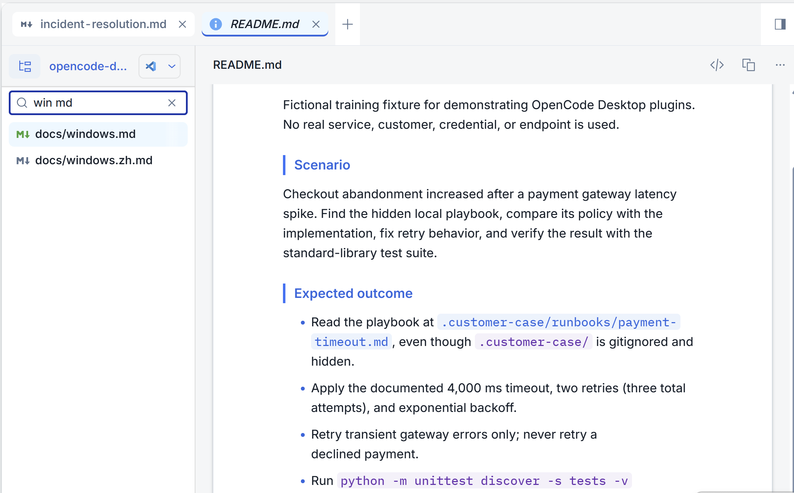
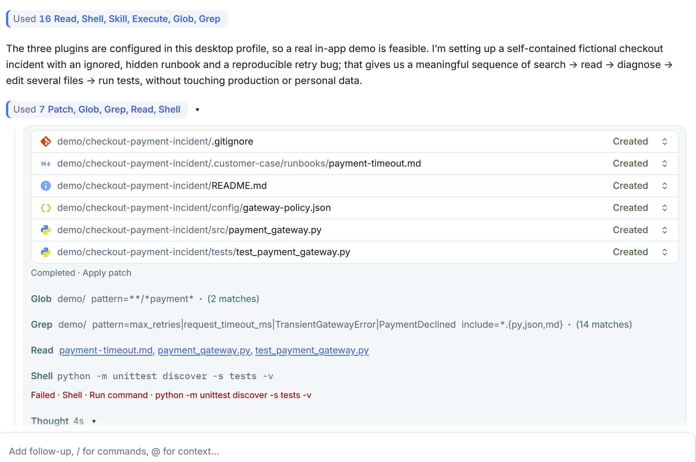
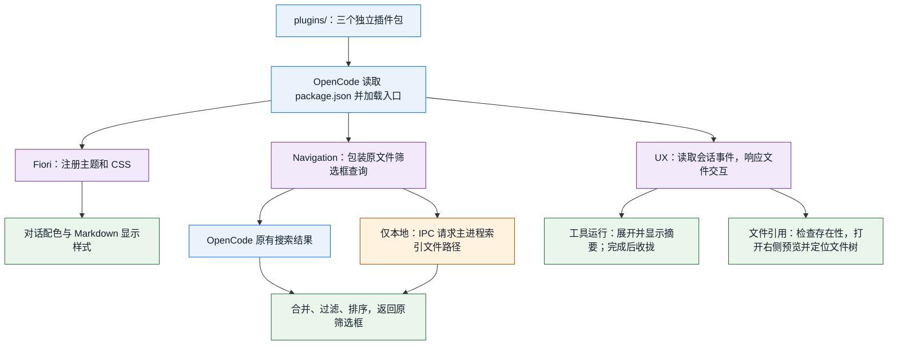

# OpenCode 桌面插件

[English](README.md)

## 这是什么

三个小插件，让 OpenCode Desktop 使用更顺手。

## 背景
最近迁移到 OpenCode 后，用它做日常工作，遇到了一些不顺手的地方，比方说：主题风格不习惯、文档阅读别扭，以及执行过程中的反馈显示不好理解。
  
AI时代，该出手时就可以出手，直接折腾AI做了一些改动尝试。

这个项目分享这些改动和背后的思路，不是官方的迁移报告。

**这是个人项目，不是 SAP 官方产品。**

逻辑上来讲这些代码都是跨平台的，但插件整体只在我当前的 Windows 电脑和当前使用的 OpenCode Desktop 上测试过。其他电脑、版本和操作系统（包括 macOS）均未验证。

## 解决什么问题

> **截图说明：** 所有截图均使用虚构的演示数据，不对应真实客户案例或事故。

### Fiori Horizon：换成接近 SAP Fiori 的风格

个人觉得OpenCode自带的主题太单调，想换成更接近 SAP Fiori 的浅色风格。它既调整主对话区的展示颜色，也调整文档浏览区 Markdown 的显示样式，包括标题、表格、引用和行内代码。不只是换一个背景色，也不是 SAP 官方主题。

### Workspace Navigation：找文件更全，打开后知道它在哪

文件面板自带的搜索不够全，打开文件后也不会主动展开父目录、选中对应节点。搜索增强沿用原来的输入框，按文件名和路径查找，并把隐藏和 gitignored 目录中的文件纳入搜索；输入多个词可以缩小范围，例如 `report md`、`docs report md`。

打开文件后自动展开父目录、选中并定位文件的功能，目前由 **UX Enhancements** 实现。想同时获得搜索和文件树跟随，需要启用这两个插件。

### UX Enhancements：过程反馈更清楚，结果更方便查看

刚开始用 OpenCode 时，总觉得它有点慢。但不确定是真的执行慢，还是界面变化不明显，让等待显得更久。所以我先想执行反馈做得更清楚：现在在做什么、执行到哪一步、什么时候结束。这改善的是等待时的体验，不代表模型或工具执行得更快。

- 工具执行时自动展开，并显示命令和操作摘要；后续回答出现或执行结束后自动收拢。需要细节时可以重新展开，原始命令和输出仍保留。
- 回复中已有的文件路径（包括末尾文件清单里的路径）可以直接点击，在右侧边栏打开。插件不会替模型生成文件清单。
- 文档可以铺满右侧面板，同时暂时隐藏对话，方便专心阅读；再次切换即可回到对话。这是应用内全宽阅读，不是 Windows 全屏。

此外，打开文件时会在文件树中展开父目录、选中并定位文件；也可以编辑本地文本文件，或复制文件内容和路径。

三个插件可以一起使用，也可以只复制需要的插件文件夹。搜索和 UX 不依赖主题；这些插件不会额外调用模型，也不修改 OpenCode 的安装文件。

## 插件怎么工作

OpenCode 读取每个插件的 `package.json`，找到并加载入口。GUI 代码分两部分运行：窗口里的 `setup` 负责界面，Electron 主进程里的 `main` 负责本地文件操作，两者通过 IPC 通信。

主题只改变显示样式。Navigation 合并原搜索和本地路径索引，不读文件正文；远程工作区不做本地补搜。UX 根据会话状态更新过程展示，检查已有文件引用后再添加链接；全宽阅读复用原审查按钮，保存则通过 IPC 检查并写入本地文件。

这些都是运行代码的 Plugin，不是给 agent 提供任务步骤的 Skill，也不是接入外部工具的 MCP；三个插件不依赖 Skill 或 MCP。

源码在 [plugins/](plugins/)。`.cjs` 文件是手写源码，也可以直接作为 GUI 入口加载。主题使用 OpenCode 的 Theme 和 Style 接口；搜索包装和部分 UX 行为依赖当前桌面界面结构，OpenCode 更新后可能需要调整。

## 按自己的习惯改

这里主要分享的是个思路，不是我的配色。  
套用星爷的话：**其实创作这个东西是很主观滴，不过你们滴批评我是一定会跟进滴**。  
审美这个东西也是很主观的，你个人的口味也是可以让 AI 跟进的。让AI帮你改，一次改一点，改到你满意为止。

各插件旁边的 `test.cjs` 是可选开发测试，不是安装步骤，OpenCode 日常使用不会运行它们。不需要另外维护编译流程或发布包。

## 安装

在 GitHub 选择 **Code → Download ZIP**，解压后，把 **plugins** 里需要的插件文件夹复制到：

`~/.config/opencode/plugins`

`~` 表示用户主目录，实际路径例如：

- **Windows**：`C:\Users\<your user>\.config\opencode\plugins`
- **macOS**：`/Users/<your user>/.config/opencode/plugins`

把 `<your user>` 换成自己的用户目录名。Windows 文件资源管理器请用实际路径，不要直接输入 `~`；macOS 可在 Finder 的“前往文件夹”中输入 `~/.config/opencode/plugins`。macOS 路径只是安装位置参考，插件尚未在 Mac 上验证。

安装、使用和移除步骤见 [Windows 手工指南](docs/windows.zh.md)。

## 限制与注意

- GUI API 是实验性的，OpenCode 升级后界面适配可能失效，遇到问题先关闭对应插件。
- 搜索只查名称和路径，不查正文。本地索引跳过符号链接及常见依赖、缓存目录；最多扫描 150000 个文件，缓存 15 秒，最多返回 5000 项。远程工作区没有本地补搜。
- 编辑只支持不超过 2 MB 的本地文本，保存直接写原文件，不是原子保存。关闭窗口会丢失未保存草稿。重要文件仍要备份或使用版本控制；它不是完整 IDE。
- 插件可以访问本地文件，桌面文件操作不经过 agent 权限确认。`%LOCALAPPDATA%\Temp\opencode` 下的诊断 JSON 可能包含文件路径，分享前先检查。
- 辅助文案支持中英文，不指定模型语言。离线测试通过，但最新独立搜索、真实语言切换和部分桌面操作仍需完整手工检查。

## 许可

本项目代码和文档采用 [MIT](LICENSE)。Horizon 配色参考保留 [第三方说明](THIRD-PARTY-NOTICES.zh.md)及 Apache-2.0 许可。本项目与 SAP SE 和 OpenCode 维护团队无隶属关系，未获其背书或支持。
